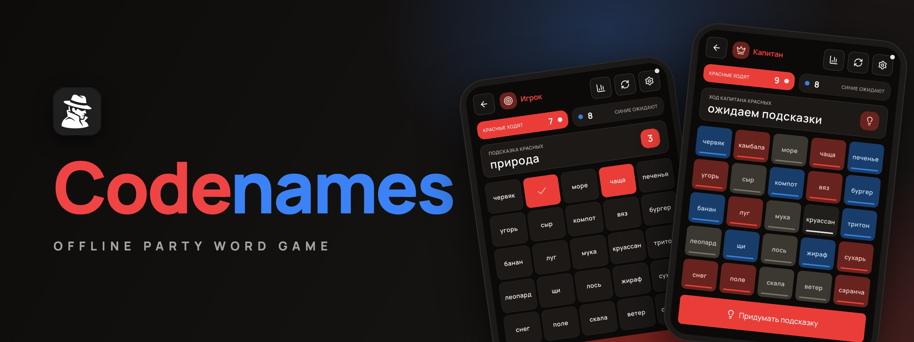
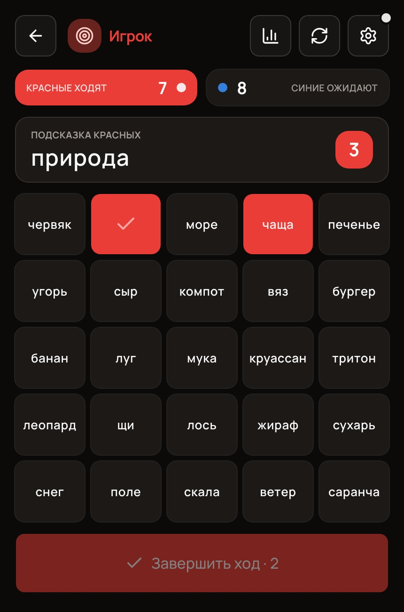
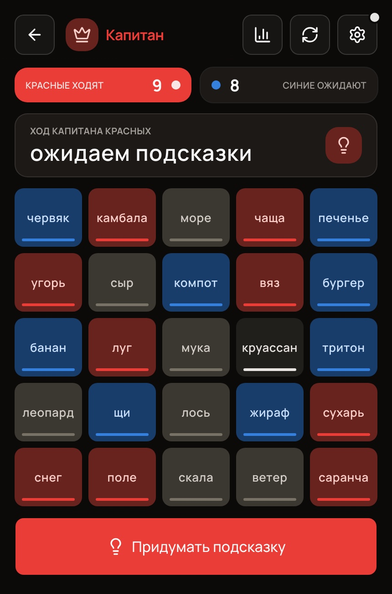

<p align="center">
	
	<a href="README.ru.md"></a>
</p>

<p align="center">
	<a href="https://codenames.aimuzov.online"></a>
</p>

<p align="center">
	<a href="https://github.com/aimuzov/codenames/actions/workflows/deploy.yml"></a>
	<a href="https://codenames.aimuzov.online"></a>
	<a href="package.json"></a>
	<a href="https://astro.build"></a>
	<a href="https://svelte.dev"></a>
	<a href="LICENSE"></a>
</p>

<h3 align="center">Codenames for a phone that needs no internet</h3>
<p align="center">One device on the table, a room code or a hotspot network, a PWA with the word packs inside</p>

<table>
	<tr>
		<td width="50%" align="center"><br><b>Board</b> for the players</td>
		<td width="50%" align="center"><br><b>Key</b> for the spymaster</td>
	</tr>
</table>

Lives at [codenames.aimuzov.online](https://codenames.aimuzov.online). It installs to the home screen as a PWA together with the word packs, and once installed it starts and plays with no network. A static [Astro](https://astro.build) site with Svelte islands plus a small WebSocket relay (`src/backend/`) for room codes.

The interface and the built-in word packs are in Russian, so the button names below are translated.

## Game modes

### One device

A phone or a tablet lies on the table, no network needed. Before a team's turn the app asks to hand the phone to the spymaster: they tap "Show board", see the key and give a clue. Then the key hides and the team reveals words on the same screen. Once the turn passes, the app covers the board again and calls the other team's spymaster.

### Room code

Everyone plays on their own phone, internet required: rooms live on a relay on the same server as the game.

1. Host: "Create" → a six-digit code and a QR with it appear on the screen.
2. Everyone else: "Join" → "Enter code" → type the code or scan the QR.
3. Then as usual: team, role, "Start game".

> A phone fell asleep, the network dropped, the app was unloaded from memory: the player comes back on their own, to their own seat. If the host falls asleep, the room waits for them for half an hour and the guests stay in it.

### No internet

Everyone plays on their own phone, yet neither Wi-Fi nor mobile data is needed: phones connect directly over WebRTC and the handshake goes through QR codes.

1. Host: "Create" → "Play offline", picks the word packs, a team and a role.
2. The host turns on the **personal hotspot**, everyone else joins it over Wi-Fi.
3. Guest: "Join" → enters a name → "Nearby, no internet" → shows their **QR (offer)** to the host.
4. Host: "Add player" → scans the guest's QR → shows the **QR (answer)** in return.
5. The guest scans the answer and the connection is up. The guest picks a team and a role.
6. When everyone is in, the host taps "Start game".

> If the camera is unavailable, the scanner has "Enter code manually": codes can be passed as text.

## What's inside

- **Anti-cheat**: the host sends card colors to spymasters only, players get just the words and the cards already revealed, so the key can't be peeked at through devtools.
- **Rejoining**: a device that fell asleep keeps its seat, the player comes back with the same team, role and the current game state. The screen stays on during a game (can be turned off in settings).
- **Word packs**: built-in Russian packs (base, "Food and drinks", "Space") and importing your own lists, stored in IndexedDB. Everything is cached for offline play.
- **Turn timer, sound, animations, theme**: configurable.

## Running

Stack and layout follow [infra-site-template](https://github.com/aimuzov/infra-site-template): Astro + Svelte 5, Prettier, oxlint, stylelint (BEM), `node --test`. Node comes from `mise.toml`, the same version is pinned in `package.json`.

```sh
cp .env.example .env
npm ci
npm run dev       # https://localhost:4321, also reachable over the network for testing from a phone
npm run relay     # room relay on :8787, the dev server proxies /ws to it
```

Before committing, the same checks as in CI:

```sh
npm run format:check && npm run lint:js && npm run lint:css && npm run check && npm test && npm run build
```

The e2e tests in [`e2e`](e2e) run on the preset of [infra-site-kit](https://github.com/aimuzov/infra-site-kit): they build the site with the test hooks on, serve it with `astro preview`, start the relay next to it and play the game in Chromium emulating a phone. On top of the game scenarios, the kit checks that the page answers without console errors and passes axe. The browser is installed once with `npx playwright install chromium`, then `npm run test:e2e`.

## Architecture

The main principle: **the game core knows nothing about the network**, which makes it testable and gives the one-device mode for free.

```
src/
  frontend/      the game (Astro + Svelte)
    game/        pure core: createGame, reducer, rules, redact (anti-cheat), types
    data/        word packs (JSON), registry, custom pack import into IndexedDB
    signaling/   codec (SDP compressed into a string), base45, sdp
    transport/   types (transport contract), webrtc + host-hub (QR/P2P), ws-relay (rooms),
                 game message protocol
    state/       session (modes and actions), net (host/guest orchestration), persist-session,
                 device-id, settings, ui
    screens/     screens: home, host-lobby, join, board, packs, settings…
    components/  shared components, ui/ for primitives, game/ and net/ for the board and connecting
    audio/       sfx (Web Audio)
  backend/       room relay (Node, no build step: TypeScript runs directly)
  shared/        relay message envelope shared by the game and the server
```

- **State**: atoms on `svelte/store` (`lib/atom.ts`). In components they are plain stores (`$atom`), while state modules don't depend on the Svelte compiler and are tested in plain Node.
- **Host authority**: the host applies events through `reducer` after validation (`validateIntent`) and sends each player a state redacted for their role (`redactStateForRole`).
- **Transport**: two interchangeable ones behind a shared contract in `transport/types.ts`, the session layer doesn't know which is underneath. WebRTC over the local network with no STUN/TURN (SDP is compressed with pako and encoded into a QR) and a WebSocket relay with room codes. The relay doesn't parse game messages, it only routes them.
- **Player identity**: the device id lives in localStorage and arrives in `hello`, so the host recognizes a player coming back after a drop and puts them in their old seat. Transport connection and player are separate: one player may go through any number of connections during a game.
- **Resilience**: a heartbeat both ways (a frozen webview often dies without `close`), a session snapshot in localStorage in case the PWA is unloaded from memory, Screen Wake Lock during a game.

## Tests

Unit tests (`node --test`) cover the pure core and the protocol:

- the 9/8/7/1 deal, turn changes, winning and losing, the guess limit;
- key redaction by role (anti-cheat);
- the signaling codec (roundtrip, compression);
- intent validation (who may act and when);
- lobby, player rejoin and session restore over a stubbed transport.

End-to-end tests (Playwright, a real WebRTC DataChannel and a real relay) cover the handshake, clue and reveal sync, key privacy, rejection of illegal actions, and resilience: rejoining after a drop, restarting the app on a guest and on the host, automatic reconnection in a room (the drop is simulated with `context.setOffline`).

## Deployment

The projects server from [infra-server](https://github.com/aimuzov/infra-server): merging the release PR that release-please keeps open runs `deploy.yml`, which runs the checks and calls the shared [`deploy/site.sh`](https://github.com/aimuzov/infra-server/blob/main/deploy/site.sh) of infra-server over SSH. On the server `docker compose` builds two containers: `codenames` (nginx with the static site) and `codenames-relay` (the room relay). The domain, TLS and the `/ws` route to the relay are handled by the shared Caddy (`sites/codenames.caddy`).

> HTTPS is required by the camera (`getUserMedia`) and the service worker. The server only hands out and installs the PWA: after installation the QR game works offline, and WebRTC signaling goes over the local network.

## License

[MIT](LICENSE)
