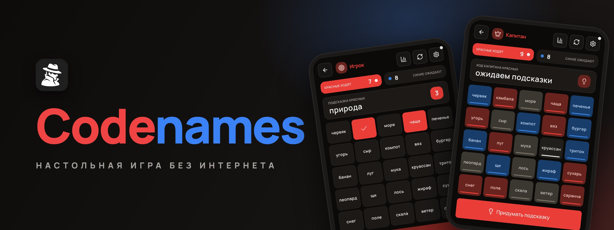

<p align="center">
	<a href="README.md"></a>
	
</p>

<p align="center">
	<a href="https://codenames.aimuzov.online"></a>
</p>

<p align="center">
	<a href="https://github.com/aimuzov-projects/codenames/actions/workflows/deploy.yml"></a>
	<a href="https://codenames.aimuzov.online"></a>
	<a href="package.json"></a>
	<a href="https://astro.build"></a>
	<a href="https://svelte.dev"></a>
	<a href="LICENSE"></a>
</p>

<h3 align="center">Codenames для телефона, которому не нужен интернет</h3>
<p align="center">Одно устройство на столе, комната по коду или сеть через хотспот -- PWA со словарями внутри</p>

<table>
	<tr>
		<td width="50%" align="center"><br><b>Поле</b> у игроков</td>
		<td width="50%" align="center"><br><b>Ключ</b> у капитана</td>
	</tr>
</table>

Живёт на [codenames.aimuzov.online](https://codenames.aimuzov.online). Ставится на домашний экран как PWA вместе со словарями, после установки запускается и играет без сети. Статичный сайт на [Astro](https://astro.build) с островами на Svelte и маленький WS-релей (`src/backend/`) для комнат по коду.

## Режимы игры

### Одно устройство

Телефон или планшет лежит на столе, сеть не нужна. Перед ходом команды приложение просит передать телефон капитану: он жмёт «Показать поле», видит раскраску и даёт подсказку. После этого ключ прячется, и команда открывает слова на том же экране. Ход перешёл -- приложение снова закрывает поле и зовёт капитана соперников.

### Комната по коду

Каждый играет со своего телефона, нужен интернет: комнаты держит релей на том же сервере, что и игра.

1. Хост: «Создать» → на экране появляется шестизначный код и QR с ним.
2. Остальные: «Подключиться» → «Войти по коду» → вводят код или сканируют QR.
3. Дальше как обычно: команда, роль, «Начать игру».

> Уснул телефон, пропала сеть, приложение выгрузилось из памяти -- игрок возвращается сам, на своё место. Если уснул хост, комната ждёт его полчаса, а гости остаются в ней.

### Без интернета

Каждый со своего телефона, но ни Wi-Fi, ни мобильный интернет не нужны: телефоны связываются напрямую по WebRTC, а рукопожатие идёт через QR-коды.

1. Хост: «Создать» → «Играть без интернета», выбирает словари, команду и роль.
2. Хост включает **режим модема (личный хотспот)**, остальные подключаются к нему по Wi-Fi.
3. Гость: «Подключиться» → вводит имя → «Рядом, без интернета» → показывает хосту свой **QR (offer)**.
4. Хост: «Добавить игрока» → сканирует QR гостя → показывает ответный **QR (answer)**.
5. Гость сканирует ответный QR -- соединение установлено. Гость выбирает команду и роль.
6. Когда все в сборе, хост жмёт «Начать игру».

> Если камера недоступна, в сканере есть «Ввести код вручную» -- коды можно передать строкой.

## Что внутри

- **Анти-чит**: цвета карт хост рассылает только капитанам, игроки получают лишь слова и уже открытые карты -- подсмотреть ключ через devtools нельзя.
- **Возврат в игру**: уснувшее устройство не теряет место -- игрок возвращается с той же командой, ролью и текущим состоянием партии. Экран во время игры не гаснет (отключается в настройках).
- **Словари**: встроенные русские паки (база, «Еда и напитки», «Космос») и импорт своих списков, они хранятся в IndexedDB. Всё кэшируется для офлайна.
- **Таймер хода, звук, анимации, тема**: настраиваются.

## Запуск

Стек и раскладка как в [infra-site-template](https://github.com/aimuzov-projects/infra-site-template): Astro + Svelte 5, Prettier, oxlint, stylelint (BEM), `node --test`. Node берётся из `mise.toml`, та же версия закреплена в `package.json`.

```sh
cp .env.example .env
npm ci
npm run dev       # https://localhost:4321, доступен и по сети для теста с телефона
npm run relay     # WS-релей комнат на :8787, dev-сервер проксирует к нему /ws
```

Перед коммитом -- те же проверки, что в CI:

```sh
npm run format:check && npm run lint:js && npm run lint:css && npm run check && npm test && npm run build
```

Сквозные тесты сами поднимают dev-сервер и релей: `npm run test:e2e`.

## Архитектура

Главный принцип -- **игровое ядро не знает о сети**, что даёт тестируемость и режим «одно устройство».

```
src/
  frontend/      игра (Astro + Svelte)
    game/        чистое ядро: createGame, reducer, rules, redact (анти-чит), типы
    data/        паки слов (JSON), реестр, импорт кастомных в IndexedDB
    signaling/   codec (сжатие SDP в строку), base45, sdp
    transport/   types (контракт транспорта), webrtc + host-hub (QR/P2P), ws-relay (комнаты),
                 протокол игровых сообщений
    state/       session (режимы и действия), net (оркестрация хост/гость), persist-session,
                 device-id, settings, ui
    screens/     экраны: home, host-lobby, join, board, packs, settings…
    components/  общие компоненты, ui/ -- примитивы, game/ и net/ -- доска и подключение
    audio/       sfx (Web Audio)
  backend/       WS-релей комнат (Node, без сборки -- TypeScript исполняется напрямую)
  shared/        конверт сообщений релея, общий для игры и сервера
```

- **Состояние**: атомы на `svelte/store` (`lib/atom.ts`). В компонентах это обычные сторы (`$atom`), а модули состояния не зависят от компилятора Svelte и тестируются в чистом Node.
- **Хост-авторитет**: хост применяет события через `reducer` после валидации (`validateIntent`) и рассылает каждому игроку состояние, отредактированное под его роль (`redactStateForRole`).
- **Транспорт**: два взаимозаменяемых, с общим контрактом в `transport/types.ts`, слой сессии не знает, какой под ним. WebRTC поверх локальной сети без STUN/TURN (SDP сжимается pako и кодируется в QR) и WS-релей с комнатами по коду. Релей не разбирает игровые сообщения, а лишь маршрутизирует их.
- **Личность игрока**: id устройства живёт в localStorage и приходит в `hello`, поэтому хост узнаёт вернувшегося после обрыва игрока и сажает его на прежнее место. Транспортное соединение и игрок разведены: за партию соединений у одного игрока может смениться сколько угодно.
- **Живучесть**: пульс в обе стороны (замороженный вебвью часто умирает без `close`), снимок сессии в localStorage на случай выгрузки PWA из памяти, Screen Wake Lock во время игры.

## Тесты

Юнит-тесты (`node --test`) покрывают чистое ядро и протокол:

- раздача 9/8/7/1, переходы ходов, победа и проигрыш, лимит угадываний;
- редактирование ключа по роли (анти-чит);
- кодек сигналинга (roundtrip, сжатие);
- валидация интентов (кто и когда вправе действовать);
- лобби, возврат игрока и восстановление сессии на подменённом транспорте.

Сквозные тесты (Playwright, настоящий WebRTC DataChannel и настоящий релей) покрывают рукопожатие, синхронизацию подсказки и открытий, приватность ключа, отклонение нелегальных действий, а также живучесть: возврат в партию после обрыва, перезапуск приложения у гостя и у хоста, автоматическое переподключение в комнате (обрыв имитируется через `context.setOffline`).

## Деплой

Сервер projects из [infra-server](https://github.com/aimuzov-projects/infra-server): пуш в `main` запускает `deploy.yml`, тот прогоняет проверки и по SSH дёргает общий [`deploy/site.sh`](https://github.com/aimuzov-projects/infra-server/blob/main/deploy/site.sh) из infra-server. На сервере `docker compose` собирает два контейнера: `codenames` (nginx со статикой) и `codenames-relay` (релей комнат). Домен, TLS и маршрут `/ws` к релею держит общий Caddy (`sites/codenames.caddy`).

> HTTPS нужен камере (`getUserMedia`) и сервис-воркеру. Сервер -- лишь точка раздачи и установки PWA: игра по QR после установки работает офлайн, WebRTC-сигналинг идёт по локальной сети.

## Лицензия

[MIT](LICENSE)
